# Agent-built UI: Microsoft Copilot Studio + A2UI

**The agent decides what you see. Your app decides what is allowed.**

This TypeScript sample gives a Microsoft Copilot Studio (MCS) agent its own custom user interface. The agent doesn't reply with chat text. It replies with an **[A2UI](https://a2ui.org/quickstart/) v0.9 surface**: cards, tabs, sliders, date pickers, modals and buttons. A small Node backend calls the agent over **Direct-to-Engine (D2E)**, validates every surface strictly, and passes it to the **official A2UI React renderer**. When the user clicks something, the click goes back to the **same agent conversation**, and the agent answers with an updated surface.

We are sharing this sample to show one pattern in practice. You keep the agent's logic in Copilot Studio, where makers can change it, and you own the screen. You do this without Direct Line, without an extra LLM, and without hand-coding a React form for each scenario.

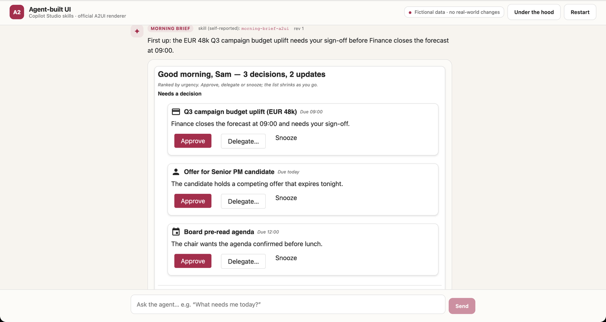

## Why this matters

| Question | Answer in this sample |
| --- | --- |
| Who designs each screen? | The **agent**. Four Copilot Studio **skills** each hold one A2UI v0.9 template plus the state rules for it. |
| Who decides what is allowed? | The **backend**. It applies per-scenario component allowlists, action-name rules, size and depth limits, and the official A2UI processor in strict mode. |
| Who draws it? | The **official A2UI renderer** (`@a2ui/react`, Basic Catalog). The sample uses no custom components. |
| How do clicks reach the agent? | Native A2UI actions are sent to the **same D2E conversation** as a versioned JSON envelope. |
| What happens to the real world? | **Nothing.** All data is fictional. The agent has no tools, connectors, WorkIQ or knowledge sources. |

## The four scenarios

The scenarios run in the order **P → O → D**: a quick win first, then the clearest contrast, then the control story. The desk scenario is a bonus.

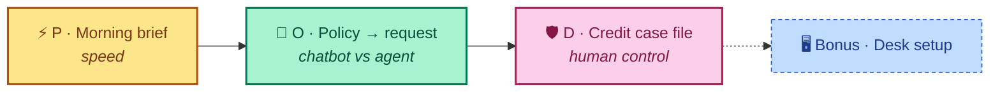

### P · Executive morning brief: *"What needs me today?"*

The agent ranks five items by urgency. A Divider separates **Needs a decision** from **For your information**. Each card has Approve, Delegate or Snooze. Delegate opens a Modal for a short note, and the list gets shorter after every action.

| Ranked brief | Delegate with a note | The list shrinks |
| --- | --- | --- |
|  | 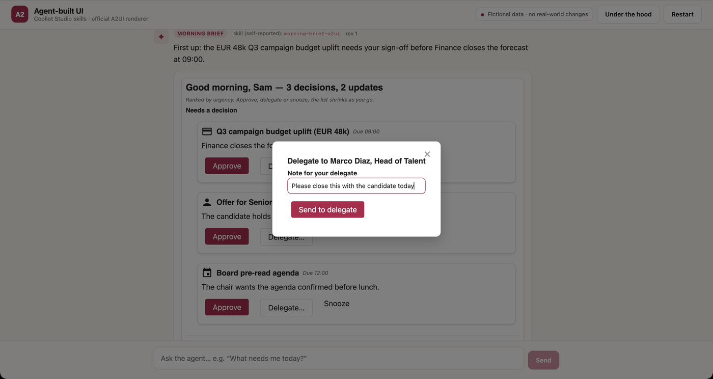 | 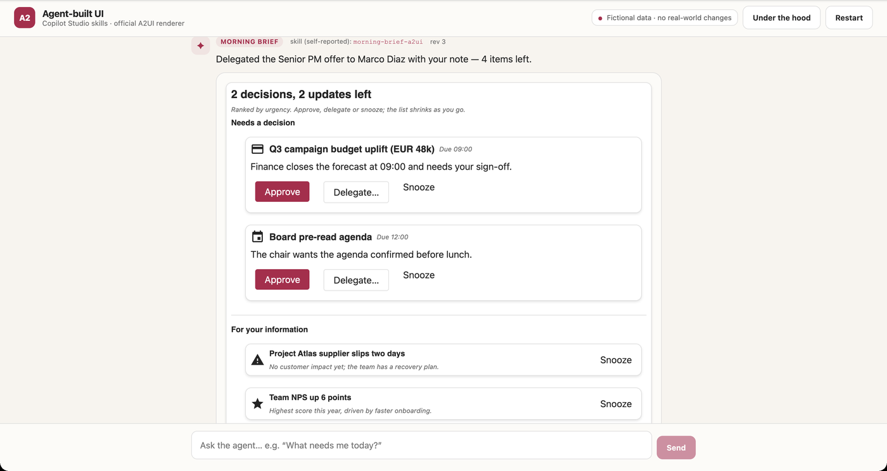 |

*Skill:* `morning-brief-a2ui` · *Components:* Column, Card, List, Row, Text, Icon, Button, Divider, Modal, TextField

### O · Policy answer that becomes a request: *"Can I work from Lisbon for six weeks?"*

The agent gives a short answer and shows eligibility checks with tick icons. It cites the (fictional) policy and prefills a request with the dates and the manager. When the user moves the end date to seven weeks and selects **Re-check eligibility**, the agent flips one check to a cross and explains why. The agent also refuses to submit dates that break the policy.

| Answer + prefilled request | Seven weeks: one check flips |
| --- | --- |
| 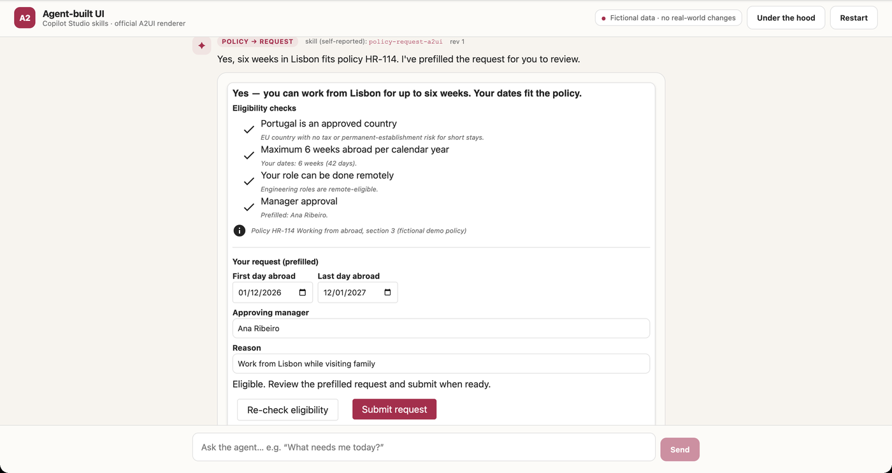 | 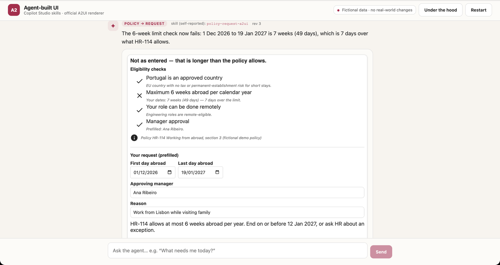 |

*Skill:* `policy-request-a2ui` · *Components:* Card, List, Icon, Text, DateTimeInput, TextField, Button, Divider

### D · Credit limit case file: *"Open the credit limit request for Northwind"*

The surface opens with a customer header and Tabs for Financials, Payment history and Recent news. A **slider** sets the proposed limit, and the agent's recommendation is shown in text. Below it are Approve, Reject and Escalate. Each decision opens a **Modal** that requires a reason before anything goes back to the agent. The receipt records whether the analyst went below the agent's number.

| Case file | Decision needs a reason | Receipt |
| --- | --- | --- |
| 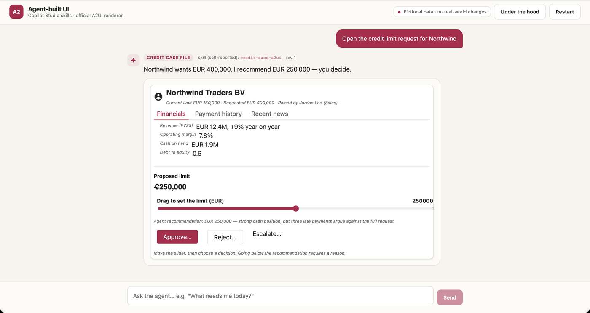 | 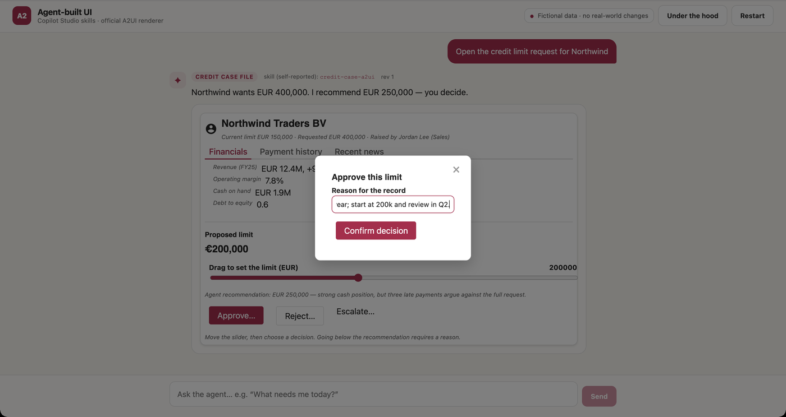 | 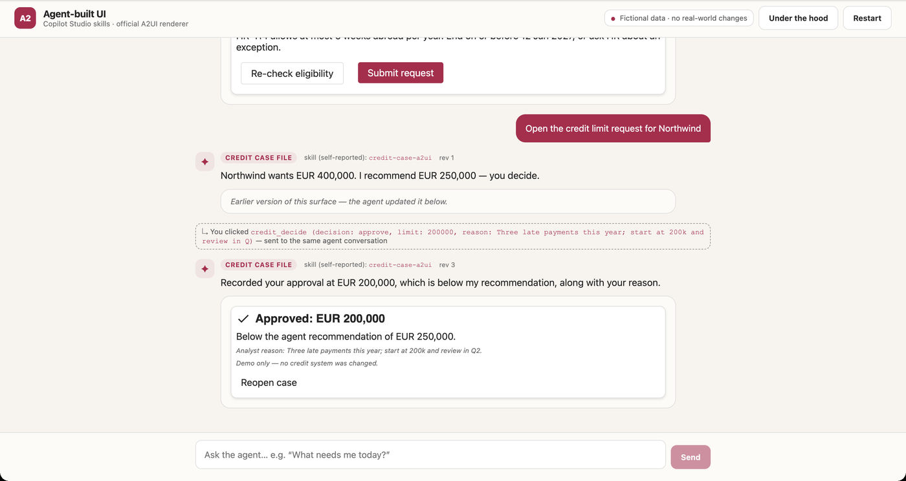 |

*Skill:* `credit-case-a2ui` · *Components:* Card, Tabs, Column, Row, List, Text, Icon, Slider, Button, Modal, TextField, Divider

The human decision point is a designed control, not a sentence such as "reply yes to confirm".

### Bonus · Desk setup: *"I need a laptop for local development"*

The agent proposes a device. The user switches the ChoicePicker (laptop, monitor or headset) and edits the reason. The receipt repeats the edited values and ends with *"Demo request received — nothing was purchased or submitted."*

*Skill:* `desk-setup-a2ui` · *Components:* Card, ChoicePicker, Icon, Text, TextField, Button

## How it works, in plain language

Think of the app as a restaurant:

- **The agent is the chef.** It decides what goes on the plate.
- **The backend is the inspector.** It checks every plate before it leaves the kitchen.
- **The A2UI renderer is the waiter.** It serves the plate to you.

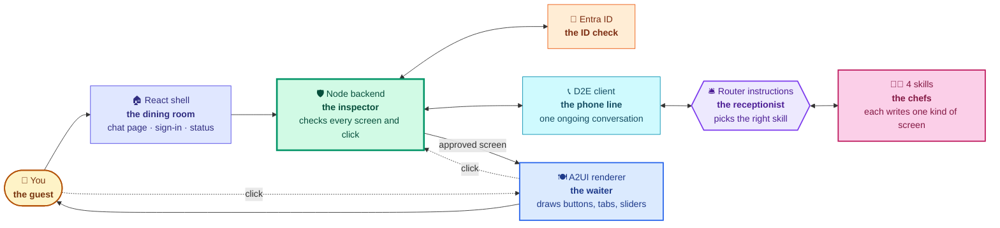

| Component | Role | What it does |
| --- | --- | --- |
| **Copilot Studio router instructions** | Receptionist | Reads your message and picks the skill that should handle it. |
| **4 skills** (`SKILL.md`) | Chefs | Each skill holds the template for one screen (brief, policy, credit or desk) and the rules for what changes when you click. It writes the screen as an A2UI description, such as "a card, a slider set to 250k and an Approve button". |
| **D2E client** (Microsoft SDK) | Phone line | Lets the backend talk directly to the agent and keeps the same conversation open for every turn. |
| **Node backend** | Inspector | Signs you in. Keeps your token and conversation ID hidden on the server. Checks every screen the agent sends, and forwards a click only if that button was on the screen you saw. |
| **A2UI renderer** (official) | Waiter | Turns the approved description into real buttons, tabs, sliders and pop-ups. It handles slider moves and pop-ups locally, without asking the agent. |
| **React shell** | Dining room | Provides the chat page, sign-in, loading states and the *Under the hood* panel. It doesn't design any scenario screen itself. |
| **Entra ID** | ID check | Proves who you are, so the agent runs on your behalf. |

Before you see a screen, the backend checks that:

- it uses only the components allowed for that scenario;
- its buttons follow the action-name rules;
- it contains no scripts, HTML or links;
- it stays within the size limits;
- the official A2UI checker accepts it.

### One click, step by step (credit case)

1. You type *"Open the credit limit request for Northwind"*.
2. The backend wraps that in a small JSON message and sends it to the agent.
3. The receptionist picks the `credit-case-a2ui` skill. The skill returns the case-file screen as A2UI JSON.
4. The inspector checks the screen. If the check fails, the backend asks the agent to fix it **once**. If it fails again, you see an error, never a made-up screen.
5. The waiter draws the screen.
6. You move the slider and type a reason. All of this happens in the browser; the agent isn't called.
7. You click **Confirm**. The inspector checks that the button was really offered, then sends *"credit_decide, 200000, reason"* to the **same** agent conversation.
8. The skill sends back a receipt screen, and the loop repeats.

### Why split it this way

- **Makers own the screens.** Edit a skill in Copilot Studio and the screen changes, with no app release.
- **Developers own safety.** The backend decides what is allowed, so the agent can't add anything dangerous.
- **Nothing touches the real world.** The agent has no tools, and all data is fictional.

## Architecture

One Node.js process serves the built React app and its API at **`http://localhost:2009`**. Vite builds the client once. The sample runs no second frontend server.

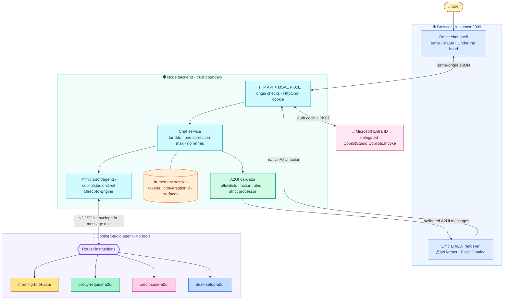

### Three responsibilities, deliberately separated

**Copilot Studio authors the UI.** The agent uses the **GitHub Copilot harness** (`cliagent-1.0.0`) with no topics and no global variables. Its global instructions are a short router. Each scenario is a runtime **skill** (`behaviors/<name>/SKILL.md`). A skill holds the A2UI template, the fictional data, and the rules for each action, such as "Delegate removes the item and records the note". Each skill's description says exactly when the orchestrator should load it.

**The backend decides what is allowed.** It never builds UI. It accepts an agent surface only if every check passes:

- The surface uses `createSurface` + `updateComponents` + optional `updateDataModel`, and every message targets one surface ID that starts with the scenario prefix (`brief-`, `policy-`, `credit-`, `desk-`).
- The Basic Catalog is used, and every component is on that **scenario's allowlist**. For example, only `credit` may use Tabs.
- Button actions are server events named `<scenario>_<verb>`, or local `open_*` events with no context. Function calls are not allowed.
- No string contains script, HTML or URL schemes. The surface stays within 120 components, a tree depth of 10, 500 characters per string and a 16 KB data model.
- The **official `MessageProcessor` in strict v0.9 mode** must accept it.

**React hosts the official renderer.** The chat shell is ordinary React. Every interactive surface is rendered by `@a2ui/react` from validated messages. Data binding, Modals, Tabs and Sliders are native renderer behaviour. The **Under the hood** panel shows the raw A2UI messages and the correlation for each turn.

### Routing to the right skill

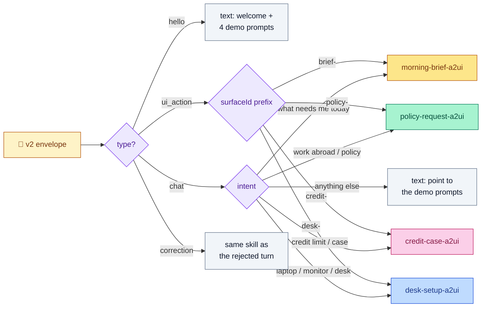

The skill descriptions follow the same rule. For example, `credit-case-a2ui`:

> Use when the user asks to review, open or decide a credit limit increase or credit case for a customer (e.g. "open the credit case for Northwind", "sales wants a higher credit limit"), or when a JSON envelope is a ui_action or correction for a surfaceId starting with credit-. Returns an agent-authored A2UI v0.9 case file with tabs, a limit slider and human decision controls. Fictional data; never changes a credit system.

### One click, one round trip

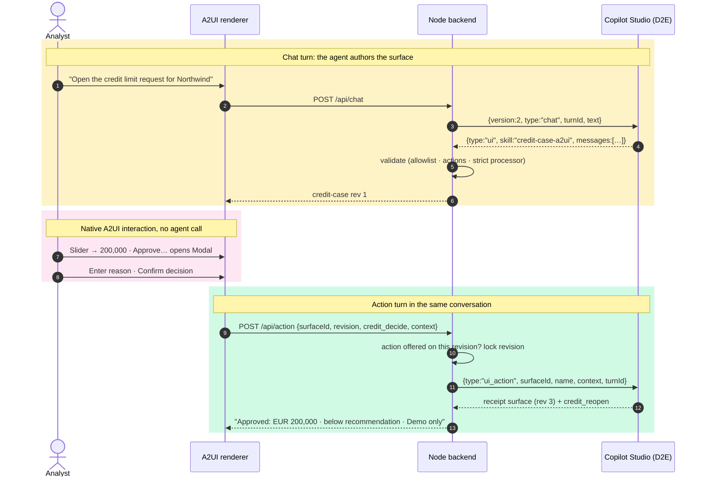

## The v2 contract

Envelopes travel as plain JSON in ordinary D2E **message text**. The sample doesn't rely on `channelData`, attachments or events.

| Direction | `type` | Fields beyond `version: 2` and `turnId` |
| --- | --- | --- |
| App → agent | `hello` | none |
| App → agent | `chat` | `text` (bounded) |
| App → agent | `ui_action` | `surfaceId`, `name`, `context` |
| App → agent | `correction` | `problem` with the validator's short reason |
| Agent → app | `ui` | `scenario`, `skill`, `text`, `messages` (A2UI v0.9) |
| Agent → app | `text` / `error` | `text` |

Rules the backend enforces:

- The agent must return exactly one JSON object of at most 64 KB that echoes the `turnId`. Duplicate JSON keys are rejected.
- If the reply is invalid, the backend sends **at most one correction**. After that the turn fails visibly, and the backend never falls back to a server-made UI.
- Actions are accepted only for the **latest revision** of a surface, and only for an action name **that revision actually offered**. The revision is locked before sending, so a slow or uncertain turn can't be clicked twice.
- Turns are serialized per session. A timeout (90 s) is **not retried**.

`skill` is self-reported by the agent. It is useful for diagnostics but is not proof of skill invocation (see [Evidence](#evidence)).

## Source map

| Location | Responsibility |
| --- | --- |
| [`src/client/main.tsx`](src/client/main.tsx) | Chat shell, official renderer per surface, action dispatch, Under the hood |
| [`src/server/server.ts`](src/server/server.ts) | Single-origin server: `/api/chat`, `/api/action`, `/api/conversation*`, `/api/reset`, auth routes, static client |
| [`src/server/chat-service.ts`](src/server/chat-service.ts) | Turn lifecycle, v2 envelopes, correction policy, revision and action checks |
| [`src/server/a2ui-validator.ts`](src/server/a2ui-validator.ts) | Allowlists, action rules, limits and the strict official processor |
| [`src/server/contracts.ts`](src/server/contracts.ts) | Zod schemas for the v2 envelopes and API input |
| [`src/server/d2e.ts`](src/server/d2e.ts) | Copilot Studio client: one plain-text reply per turn; ignores typing/trace/event activities |
| [`src/server/auth.ts`](src/server/auth.ts) | MSAL authorization-code flow with PKCE |
| [`src/server/session-store.ts`](src/server/session-store.ts) | In-memory sessions and serialized operations |
| [`agent/MCS_A2UI_GH_CLEAN/settings.mcs.yml`](agent/MCS_A2UI_GH_CLEAN/settings.mcs.yml) | Harness configuration and router instructions |
| [`agent/MCS_A2UI_GH_CLEAN/behaviors/`](agent/MCS_A2UI_GH_CLEAN/behaviors/) | The four skills (`SKILL.md` + `skill.mcs.yml`) |
| [`tests/demo.test.ts`](tests/demo.test.ts) | Validator, parser, D2E adapter and conversation-flow tests |

Pinned versions: `@a2ui/react` and `@a2ui/web_core` **0.14.0** (A2UI wire protocol **v0.9** via the `v0_9` entry points), `@microsoft/agents-copilotstudio-client` **1.10.1**, `@fontsource/material-icons` **5.3.0** (the renderer emits Material Icons ligatures; the host must supply the font). Package versions and protocol versions are different things, so upgrade the renderer and core together.

## Run the sample

### Prerequisites

- Node.js **22.9+** (verified on 22.23.1) and npm.
- A published Copilot Studio agent that supports delegated D2E invocation.
- An Entra public-client registration in your tenant, with delegated **`CopilotStudio.Copilots.Invoke`** on the **Power Platform API**. Your tenant policy may require admin consent.

### Configure the agent

Everything lives in [`agent/MCS_A2UI_GH_CLEAN/`](agent/MCS_A2UI_GH_CLEAN/):

1. **Four skills** in `behaviors/*/SKILL.md`, each with `skill.mcs.yml` (`kind: InlineAgentSkill`).
2. **Router instructions** at `configuration.agentSettings.instructions.segments[0].value` in `settings.mcs.yml`.

The sample agent was updated with the Power Platform CLI on a sync-connected clone. A fresh clone confirmed the changes before publishing:

```sh
pac copilot clone --bot <agent-id> --environment <dataverse-url> --output-dir <dir>
# add behaviors/<skill>/ and edit the router instructions
pac copilot push --project-dir <dir>/<agent>
pac copilot publish --bot <agent-id> --environment <dataverse-url>
```

The agent must have **no write tools**. Check that WorkIQ and IQ capabilities are absent, and that default WorkIQ inclusion is disabled. Keep unrelated configuration when you adapt an existing agent. Don't blindly push this workspace into another agent. The skills were tested only with this harness, so any other harness must be verified separately.

To change a screen, edit the template in that skill's `SKILL.md`, then push and publish. The app doesn't need a change unless a new component type or action name falls outside the validator's allowlist. In that case, update the allowlist and add a test.

### Configure Entra and local settings

Register **`http://localhost:2009/auth/callback`** as the public-client redirect URI. No client secret is needed.

```sh
cp .env.example .env
```

The checked-in example contains the original sample deployment's identifiers. They do not grant access, so replace them with your own values.

| Variable | Value |
| --- | --- |
| `MCS_TENANT_ID` | Your Entra tenant ID |
| `MCS_AGENT_ENVIRONMENT_ID` | Your Copilot Studio environment ID |
| `MCS_AGENT_SCHEMA_NAME` | The agent's schema name, not its display name or GUID |
| `ENTRA_CLIENT_ID` | Your public-client application ID |
| `AUTHORITY_URL` | `https://login.microsoftonline.com` (public cloud) |
| `MCS_AGENT_READY` | Keep `false` until the published agent is verified safe, then set it to `true` |
| `LOG_LEVEL` | `INFO` by default |

An Azure CLI token or a Copilot Studio portal login is not a substitute for application delegated sign-in.

### Build and start

```sh
npm ci
npm run typecheck
npm test
npm run build
npm start
```

Open **[http://localhost:2009](http://localhost:2009)** in the browser of your choice and select **Sign in**. Use the hostname `localhost`, because `127.0.0.1` is rejected. Complete sign-in in the same browser session. A server restart clears all sessions, and changes to `.env` require a restart.

## Authentication, safety and limits

- Access tokens and the D2E conversation ID stay in backend memory. The browser gets only an opaque `HttpOnly`, `SameSite=Lax` cookie. PKCE and state checks protect sign-in, POSTs require the expected origin, and sessions expire after 30 minutes of inactivity.
- **No business writes.** No tickets, approvals, credit changes, HR requests, purchases or Dataverse records are created. Every receipt says so explicitly.
- The agent's output is instruction following, **not constrained decoding**. Validation is what makes it safe to render: a malformed or out-of-contract surface becomes a visible error, never a fallback UI.
- The one-correction policy suits this no-effect demo. It is not an exactly-once strategy for agents that have side effects.
- The router forbids web search, but the portal's web-search toggle is still on, so this is an instruction-level control, not a hard one.
- This is a local POC. Production use needs an HTTPS hosting and auth design, persistent session handling, monitoring, and an independent review of agent permissions.

## Evidence

**Automated** (`npm test`, 9 tests). The tests cover:

- strict JSON parsing (duplicate keys, oversize payloads)
- the D2E multi-activity adapter
- that **every SKILL.md template passes the strict validator**
- rejection of unsafe surfaces
- `turnId` echo
- actions returning to the same conversation
- the one-correction-then-fail rule
- no retry after a timeout
- bounded chat input

`npm run typecheck` and `npm run build` also pass.

**Live, 2026-11-16.** A user signed in with real delegated auth against the published agent, with no fixtures. All four scenarios worked end to end in one conversation:

| Scenario | Verified interaction |
| --- | --- |
| P | Approve, Delegate (Modal + note) and Snooze all worked; the list shrank on every revision |
| O | Re-check at 49 days flipped the duration check to a cross; submitting 49 days was refused; 42 days gave a receipt |
| D | 51-component case file; slider to 200,000 → Approve Modal; Confirm stayed disabled until a reason was entered; the receipt flagged "below the agent recommendation" |
| Desk | Switched to Monitor, edited the reason, and the receipt repeated both with "nothing was purchased or submitted" |

Server log lines recorded the self-reported skill, component count, offered server actions and `correctionUsed:false` for every live turn. **Direct proof** that a skill was invoked is available only in the Copilot Studio portal's activity map, because D2E returns only a `turn.complete` event for this harness. Set `LOG_LEVEL=DEBUG` to log D2E activity names (never their values).

| Symptom | Action |
| --- | --- |
| Agent calls are gated | Verify the published no-write agent, set `MCS_AGENT_READY=true`, and restart |
| Admin approval required | Ask your Entra admin for delegated `CopilotStudio.Copilots.Invoke` consent |
| Icons show as words | The Material Icons font isn't loaded; keep the `@fontsource/material-icons` import |
| "Protocol" or validation error on a turn | Open **Under the hood**, read the validator reason, and fix the skill template |
| Timeout | Don't resubmit blindly; select **Restart** for a fresh conversation |

## References

- [A2UI quickstart](https://a2ui.org/quickstart/) · [A2UI repository](https://github.com/google/A2UI)
- [Microsoft Agents Copilot Studio Node.js client sample](https://github.com/microsoft/Agents/tree/main/samples/nodejs/copilotstudio-client)
