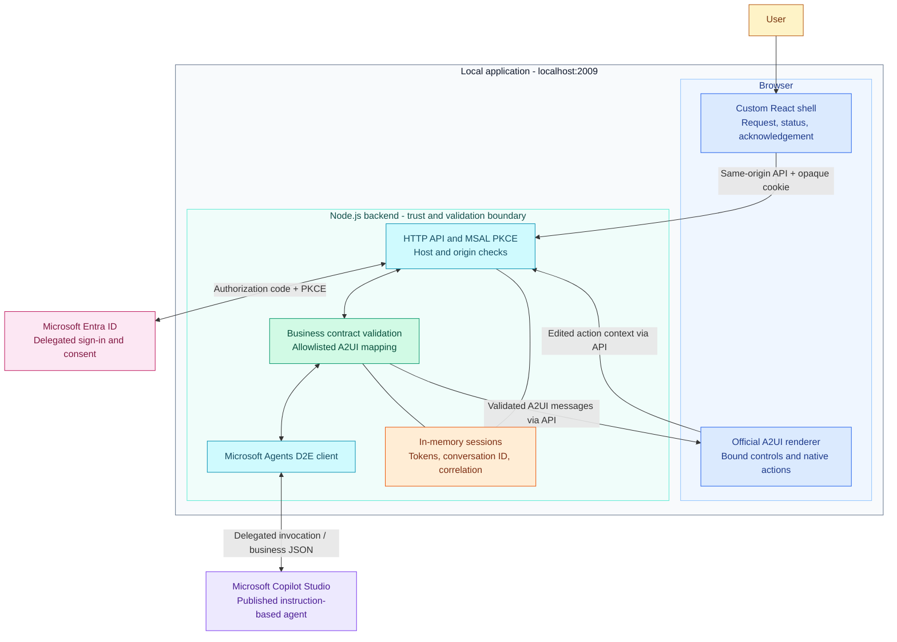
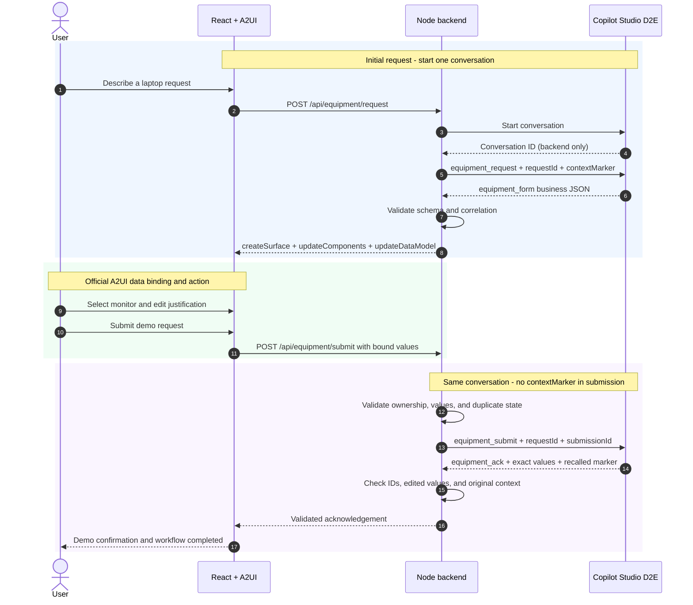

# A custom UI for Microsoft Copilot Studio, powered by A2UI

**Keep the agent in Copilot Studio. Own the user experience in your application.**

This TypeScript sample demonstrates a custom React interface for Microsoft Copilot Studio (MCS), using the official [A2UI](https://a2ui.org/quickstart/) renderer and the Microsoft Agents **Direct-to-Engine (D2E)** client. A natural-language request becomes an editable equipment form, and its submitted values return to the same agent conversation.

The purpose of sharing this sample is to make that integration pattern concrete: delegated sign-in, structured agent responses, a controlled UI contract, native A2UI interactions, and conversation continuity. It is a small, inspectable starting point for developers exploring an alternative to a chat-only interface.

> **Important boundary:** the agent returns business JSON, not React code or an arbitrary A2UI layout. The backend validates that JSON and builds one allowlisted A2UI form. This is agent-grounded data in an application-controlled UI, not unrestricted generative UI.

## What the sample demonstrates

| Capability | Implementation |
| --- | --- |
| Your own application experience | React shell, local API, sign-in, progress, errors, and diagnostics |
| Genuine A2UI controls | Official renderer, basic catalog, data binding, and native action context |
| Agent integration without another LLM | Microsoft Agents Copilot Studio client calling D2E directly |
| Multi-turn continuity | Initial request and submission use one backend-held conversation ID |
| Explicit application boundaries | Strict schemas, request ownership, correlation, and duplicate protection |

There is no Direct Line, A2A server, AG-UI layer, Python service, or additional model service in this application.

## The experience

1. Sign in, then describe the request: **"I need a laptop for running local development tools."**
2. Copilot Studio infers a device and justification. The backend validates its response and supplies an A2UI surface to the browser.
3. In the rendered form, change the device to **Monitor** and the justification to **"I need more screen space for debugging"**.
4. Submit once. The agent acknowledges those exact values in the same conversation:

   **"Demo request received — nothing was purchased or submitted."**

The original request-description box locks after form creation. Make edits in the A2UI **Device** and **Justification** controls below it.

**Screenshots:** live entry, editable-form, and acknowledgement captures are pending. They will be added from the real application, not staged responses.

## Architecture

One Node.js process serves the built React application and its API at **`http://localhost:2009`**. Vite builds the client; there is no separate frontend server at runtime.



### Three responsibilities, deliberately separated

**Copilot Studio interprets the request.** Its instructions describe a versioned equipment-request protocol. It infers supported business values and acknowledges submissions. The tested agent uses the **GitHub Copilot harness** (`cliagent-1.0.0`), with natural-language instructions and no topics or global variables. Do not treat this configuration as a classic topic-based agent template.

**The backend owns the contract and the UI definition.** It checks agent output, constructs the A2UI component tree, initializes the data model, and retains conversation/session state. An agent response cannot introduce scripts, new controls, arbitrary actions, or external business operations.

**React hosts the official A2UI renderer.** The surrounding page is ordinary React. The equipment selector, justification field, and submit action are rendered from A2UI messages using `MessageProcessor`, `A2uiSurface`, and the official basic catalog. Editing updates the native data model; submission resolves bound values into the action context.

### The request-to-acknowledgement round trip



The context marker is a small continuity check: the backend supplies it only in the first turn and requires its exact recall in the acknowledgement. It is not an authentication credential.

## Business JSON is not the A2UI protocol

The agent exchanges version-1 JSON envelopes in **ordinary message text**. For example, a valid form response looks like this:

```json
{
  "version": 1,
  "type": "equipment_form",
  "requestId": "123e4567-e89b-42d3-a456-426614174000",
  "device": "laptop",
  "justification": "Run local development tools."
}
```

The backend maps this into three **A2UI v0.9** messages:

| Message | Responsibility |
| --- | --- |
| `createSurface` | Create the equipment surface using the official basic catalog |
| `updateComponents` | Define the fixed card, text, choice picker, text field, and button |
| `updateDataModel` | Bind the validated device selection and justification |

The button emits `equipment_submit` with `/deviceSelection` and `/justification` resolved from that data model. The client sends those values to the backend; the backend creates the correlated submission envelope.

| Business envelope | Fields beyond `version` and `type` |
| --- | --- |
| `equipment_request` | `requestId`, `contextMarker`, `userText` |
| `equipment_form` | `requestId`, `device`, `justification` |
| `equipment_submit` | `requestId`, `submissionId`, `device`, `justification` |
| `equipment_ack` | `requestId`, `submissionId`, `status`, `device`, `justification`, `message` |
| `equipment_error` | `requestId`, `submissionId`, bounded `fieldErrors` |

Only `laptop`, `monitor`, and `headset` are supported. The schemas bound input sizes, reject unknown properties and blank values, and parse JSON without allowing duplicate keys. The D2E adapter requires exactly one plain-text message, rejects attachments, and ignores typing/trace/event metadata rather than treating it as business data.

## Source map and technology

| Location | Responsibility |
| --- | --- |
| [`src/client/main.tsx`](src/client/main.tsx) | React shell, official renderer lifecycle, action handling, API calls |
| [`src/server/server.ts`](src/server/server.ts) | Single-origin HTTP server, API routes, static client, cookie/origin controls |
| [`src/server/auth.ts`](src/server/auth.ts) | MSAL authorization-code flow with PKCE |
| [`src/server/d2e.ts`](src/server/d2e.ts) | Official Copilot Studio client and response-activity handling |
| [`src/server/contracts.ts`](src/server/contracts.ts) | Strict business envelopes and input validation |
| [`src/server/a2ui.ts`](src/server/a2ui.ts) | Allowlisted A2UI component tree and bound initial data |
| [`src/server/equipment-service.ts`](src/server/equipment-service.ts) | Conversation lifecycle, validation, correlation, and duplicate protection |
| [`src/server/session-store.ts`](src/server/session-store.ts) | In-memory session/workflow state and serialized operations |
| [`agent/MCS_A2UI_GH_CLEAN/settings.mcs.yml`](agent/MCS_A2UI_GH_CLEAN/settings.mcs.yml) | GitHub-harness configuration and copyable demo instructions |
| [`tests/demo.test.ts`](tests/demo.test.ts) | Contract, renderer-model, transport, and workflow regression tests |

The lockfile pins `@a2ui/react` and `@a2ui/web_core` to **0.14.0**, using their **`v0_9` entry points**, and `@microsoft/agents-copilotstudio-client` to **1.10.1**. Package versions and A2UI wire-protocol versions are different; upgrade the renderer/core together and verify the protocol before changing either.

## Run the sample

### Prerequisites

- Node.js **22.9+** and npm; the verified runtime was Node 22.23.1.
- Access to a published Copilot Studio agent supporting delegated D2E invocation.
- A suitable Entra public-client registration in your tenant, with a service principal and delegated **`CopilotStudio.Copilots.Invoke`** permission on the **Power Platform API**.
- Consent and permission to invoke that agent. Tenant policy may require administrator approval.

### Configure the agent

Use the natural-language instruction block at `configuration.agentSettings.instructions.segments[0].value` in [`settings.mcs.yml`](agent/MCS_A2UI_GH_CLEAN/settings.mcs.yml). For the tested GitHub-harness agent, this is its instructions surface, not a topic.

The demo requires a tool-free agent: verify that write-capable IQ capabilities and WorkIQ are absent and default WorkIQ inclusion is disabled. Preserve unrelated configuration and feedback when adapting an existing agent. Verify and publish the intended configuration before enabling calls. Do not blindly push the sample's connected workspace into another agent.

This harness was tested with an instruction-only contract. Another harness or agent must be configured and verified separately; copying the instructions is not proof of D2E compatibility or published behavior.

### Configure Entra and local settings

Register **`http://localhost:2009/auth/callback`** as the public-client redirect URI. No client secret is needed. Grant the delegated Power Platform permission above and obtain the consent required by your tenant.

```sh
cp .env.example .env
```

Edit the private `.env` before starting. **The checked-in example contains the original sample deployment's identifiers; they do not grant access. Replace them with your own values.**

| Variable | Value |
| --- | --- |
| `MCS_TENANT_ID` | Your Entra tenant ID |
| `MCS_AGENT_ENVIRONMENT_ID` | Your Copilot Studio environment ID |
| `MCS_AGENT_SCHEMA_NAME` | Your agent's schema name, not its display name or GUID |
| `ENTRA_CLIENT_ID` | Your public-client application ID |
| `AUTHORITY_URL` | `https://login.microsoftonline.com` (public cloud only) |
| `MCS_AGENT_READY` | Keep `false` until the published agent is verified safe; then set `true` |
| `LOG_LEVEL` | `INFO` by default |

The SDK derives the Power Platform scope from the connection settings. An Azure CLI token or a Copilot Studio portal login is not a substitute for application delegated sign-in.

### Build and start

```sh
npm ci
npm run typecheck
npm test
npm run build
npm start
```

Open **[http://localhost:2009](http://localhost:2009)** in your chosen browser. The listener binds to `127.0.0.1`, but the application requires the hostname `localhost`. No additional frontend port is used.

Select **Get sign-in link**, then open the provided Microsoft sign-in link yourself. Generate the link and complete sign-in in the **same browser session**: an embedded preview and an external browser do not share cookies. Sign-in is available while agent readiness is false; equipment calls remain gated until it is true. Changes to `.env` require a server restart.

## Authentication, safety, and limits

Access tokens and D2E conversation IDs stay in backend memory. The browser receives only an opaque `HttpOnly`, `SameSite=Lax` session cookie, not a bearer token. PKCE and state checking protect sign-in; API POSTs require the expected origin. Sessions expire after 30 minutes of inactivity, and a server restart clears all in-memory authentication and workflow state.

This sample has **no business-write integration**: no tickets, inventory, approvals, purchases, or Dataverse records are created. Its acknowledgement explicitly describes a simulation.

The backend serializes operations per session, validates request ownership and response correlation, disables duplicate submission in the UI, and deduplicates completed submissions server-side. It may send **one exact-envelope correction** after receiving invalid business output. This is appropriate only for this no-effect demo contract, not a general retry strategy for side-effecting agents. Timeouts and transport failures are never blindly retried; uncertain outcomes lock the workflow.

The agent's output remains best-effort natural-language instruction following, **not constrained decoding**. Malformed or mismatched output produces an explicit error, never a success fallback.

This is a local POC, not a production hosting template. Production work would need an HTTPS deployment/authentication design, suitable persistent session/token handling, scaling and lifecycle decisions, operational monitoring, and independent verification of agent permissions and effects.

## Adapt the pattern

Start with your business contract, not an arbitrary component generator. Extend the schemas in `contracts.ts`, keep the agent instructions aligned, and map validated values to an allowlisted surface in `a2ui.ts`. Register native action names explicitly in the client and validate them again server-side.

To add a new device or a different workflow, update the contract, component options, agent behavior, service checks, and focused tests together. Introducing tools or real writes changes the safety model: the current correction and duplicate policies are not an exactly-once transaction guarantee.

## Validation and troubleshooting

**Automated:** the 10 tests cover strict JSON/schema handling, official A2UI processing/data binding, D2E multi-activity responses, edited values in one conversation, context recall, session isolation, duplicate suppression, invalid inputs, and uncertain timeouts. `npm run typecheck` checks both client and server; `npm run build` produces the single-process application.

**Live:** user-driven browser acceptance passed on 2026-11-13 against the supplied published agent with real delegated sign-in and no fetch fixtures. The official form rendered; submission returned `monitor` and `I need more screen space for debugging`; the acknowledgement recalled the original marker and the workflow reached `completed`. Server events independently recorded form creation and a nonduplicate acknowledgement with the same request ID. This is separate from mock-based regression tests, not an unattended live test. The pasted result does not independently establish a laptop-to-monitor change.

| Symptom | Action |
| --- | --- |
| Agent calls are gated | Verify the published no-write agent, set `MCS_AGENT_READY=true`, and restart |
| Admin approval required | Ask your Entra administrator for delegated `CopilotStudio.Copilots.Invoke` consent |
| Sign-in session expired | Reload the app and generate a fresh link in the browser where you will finish sign-in |
| Original request box is locked | Edit Device and Justification in the rendered A2UI form instead |
| Protocol/schema error | Inspect sanitized diagnostics; align the agent's published instructions with the strict contract |
| Timeout or uncertain outcome | Do not blindly resubmit; restart for a fresh in-memory demo session |

The original remote agent was verified published with no active tools, default WorkIQ disabled, and feedback preserved. Its local YAML passed the Microsoft 1.9.17 validator. Do not assume sync previews are read-only: an earlier management preview logged `SaveChangesAsync`.

## References

- [Official A2UI quickstart](https://a2ui.org/quickstart/)
- [Official A2UI repository](https://github.com/google/A2UI)
- [Microsoft Agents Copilot Studio Node.js client sample](https://github.com/microsoft/Agents/tree/main/samples/nodejs/copilotstudio-client)
